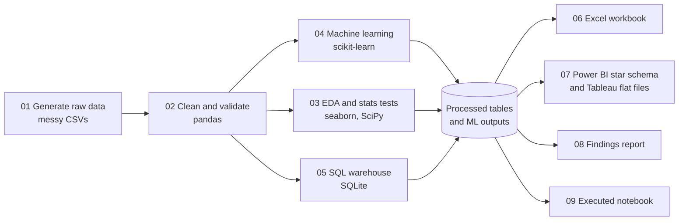
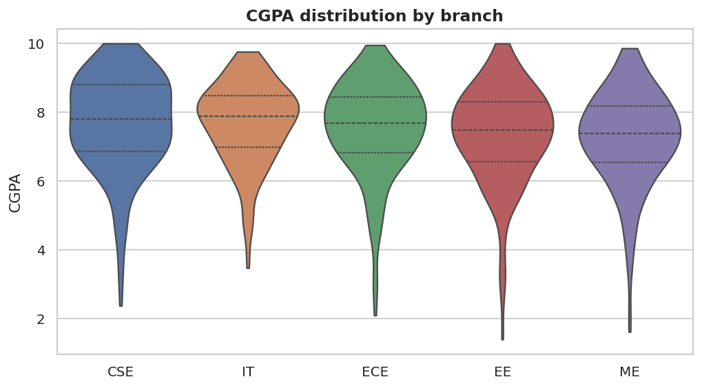
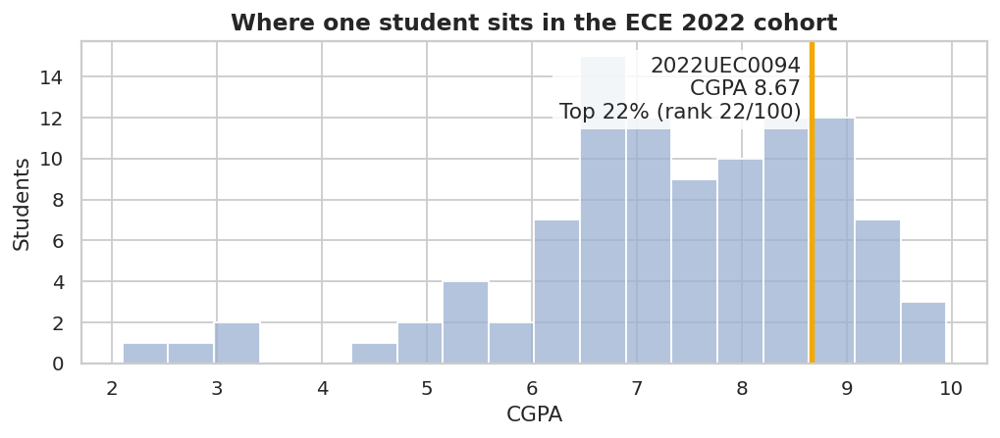
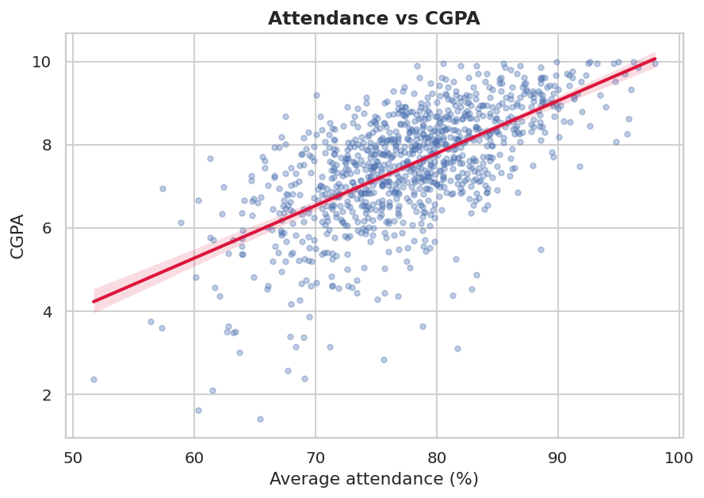
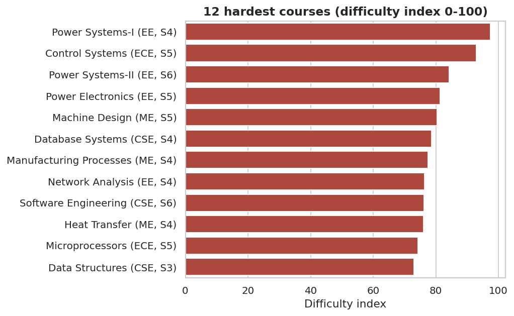
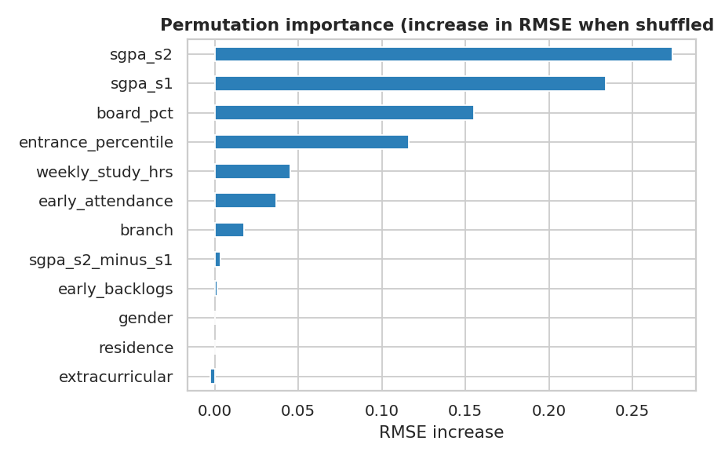
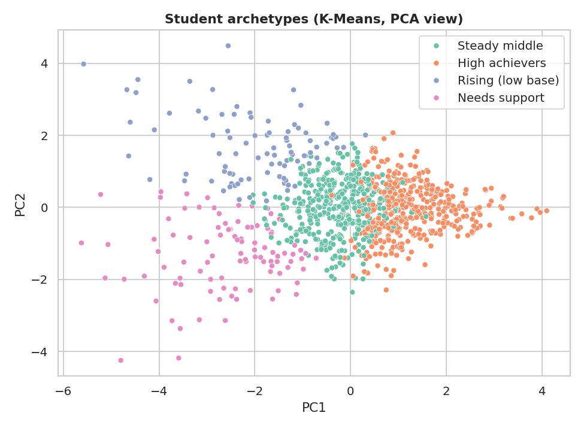

<div align="center">

# 🎓 Student Performance Analytics

### An end-to-end data analytics project inspired by university result portals like NSUT's Result Hub

**Branch-wise CGPA · Rank and percentile · Course difficulty · ML early-warning system**


</div>

---

## 📌 Table of contents
1. [Overview](#-overview)
2. [Business questions](#-business-questions)
3. [Key results](#-key-results)
4. [Pipeline architecture](#-pipeline-architecture)
5. [Visual highlights](#-visual-highlights)
6. [Tech stack](#-tech-stack)
7. [Project structure](#-project-structure)
8. [Getting started](#-getting-started)
9. [Method details](#-method-details)
10. [Excel, Power BI and Tableau](#-excel-power-bi-and-tableau)
11. [Limitations and ethics](#-limitations-and-ethics)
12. [Future work](#-future-work)
13. [Author](#-author)

---

## 🔎 Overview

University result portals show each student a CGPA, semester-wise SGPA and a rank within their branch. This project rebuilds that experience as a full analytics workflow and then goes further: it explains **why** results differ and **predicts who will struggle** after only two semesters.

The workflow covers the full analyst toolkit: messy raw data → cleaning and validation → exploratory analysis and hypothesis tests → SQL → machine learning → Excel, Power BI and Tableau.

| | |
|---|---|
| **Students** | 1,000 (5 branches × 2 batches × 100) |
| **Course results** | 24,000 rows across 88 courses and 6 semesters |
| **Raw data issues injected** | duplicates, inconsistent labels, missing values (all handled in the pipeline) |
| **Models** | Ridge, Random Forest, Gradient Boosting, Logistic Regression, K-Means |
| **Deliverables** | notebook, SQL, Excel workbook, Power BI kit, Tableau kit, written findings |

> **Data note:** all data is **synthetic**, generated by a seeded script (`src/01_generate_data.py`). No real student records are used or scraped. A hidden "ability", attendance habit, study-hours and trend drive each student's marks, so the pipeline has real structure to discover and results reproduce exactly.

## ❓ Business questions

1. Where does a student stand in their branch and batch? (rank, percentile, "Top x%")
2. What relates to CGPA: attendance, board marks, study hours, branch, hostel, gender?
3. Which courses are hardest, and how should "hard" be measured?
4. After semester 2, can we flag students likely to finish below CGPA 7.0?
5. What kinds of students exist, and what support does each need?

## 🏆 Key results

| Finding | Evidence |
|---|---|
| **Attendance is the strongest controllable factor** | Pearson r = **0.64** with CGPA. Average CGPA rises from **5.20** (<65% attendance) to **6.75** (65–75%), **7.73** (75–85%) and **8.89** (85%+) |
| **Prior academics matter most** | Board marks vs CGPA r = **0.78**; weekly self-study hours Spearman ρ = **0.41** |
| **Hostel, gender and batch do not matter** | Welch t-tests: p = 0.25 (hostel vs day scholar), 0.47 (gender), 0.12 (batch 2021 vs 2022) |
| **Branch gaps are real but small** | ANOVA F = 4.28, p = 0.002; branch means span only 7.25 (ME) to 7.69 (CSE) |
| **Later CGPA is predictable from semesters 1–2** | Ridge regression: holdout **R² = 0.86**, RMSE 0.55, MAE 0.41 (baseline R² ≈ 0) |
| **At-risk students can be flagged early** | Logistic regression: **AUC 0.97**, recall 0.90, precision 0.80 (31% of students are at risk) |
| **Risk bands are trustworthy** | Only **2.6%** of the "Low" band ended up at risk vs **81%** of the "High" band |
| **Four student archetypes** | High achievers (415), Steady middle (395), Needs support (98), Rising from a low base (92) |
| **Hardest course** | Power Systems-I (EE, semester 4), difficulty index 97 / 100 |

Full write-up with statistics and caveats: [`reports/insights.md`](reports/insights.md)

## 🏗 Pipeline architecture



## 🖼 Visual highlights

| | |
|---|---|
|  |  |
| CGPA distribution by branch | Result-Hub view: where one student sits in their cohort |
|  |  |
| Attendance vs CGPA | Twelve hardest courses by difficulty index |
|  |  |
| What drives the prediction (permutation importance) | Student archetypes (K-Means, PCA view) |

<!-- Add your own dashboard screenshots to reports/screenshots/ and uncomment:


-->

## 🧰 Tech stack

| Stage | Tools | What is demonstrated |
|---|---|---|
| Cleaning and validation | pandas, NumPy | label standardisation, de-duplication, imputation with flags, integrity assertions |
| Statistics | SciPy | ANOVA, Welch t-test, Pearson and Spearman correlation |
| Visualisation | matplotlib, seaborn | 13 publication-style figures |
| Machine learning | scikit-learn | pipelines, `ColumnTransformer`, cross-validation, `GridSearchCV`, permutation importance, ROC, K-Means, PCA, silhouette |
| SQL | SQLite | `RANK`, `PERCENT_RANK`, `LAG`, CTEs, conditional aggregation, joins to ML output |
| Spreadsheet | openpyxl + Excel | live formulas (`COUNTIFS`, `AVERAGEIFS`, `INDEX/MATCH`), lookup tool, charts, conditional formatting |
| BI | Power BI | star schema, 30+ DAX measures, row-level security |
| BI | Tableau | LOD expressions, table calculations, parameters, dashboard actions |
| Storytelling | Jupyter | executed narrative notebook |

## 📁 Project structure

```
student-performance-analytics/
├── run_all.py                 # runs the whole pipeline
├── requirements.txt
├── src/                       # numbered scripts, run in order
│   ├── 01_generate_data.py    #   synthetic, deliberately messy raw data
│   ├── 02_clean_data.py       #   cleaning, validation, CGPA/rank/percentile
│   ├── 03_eda.py              #   EDA, statistical tests, figures
│   ├── 04_ml_models.py        #   regression, classification, clustering
│   ├── 05_build_sqlite.py     #   load SQLite and run sql/queries.sql
│   ├── 06_build_excel.py      #   Excel workbook with formulas and charts
│   ├── 07_export_bi_assets.py #   Power BI and Tableau data sources
│   ├── 08_make_report.py      #   writes reports/insights.md from real outputs
│   └── 09_build_notebook.py   #   builds and executes the notebook
├── data/raw/                  # messy inputs
├── data/processed/            # clean tables and ML outputs
├── sql/queries.sql            # 9 analytical queries
├── excel/                     # Student_Performance_Analytics.xlsx
├── powerbi/                   # star-schema CSVs, measures.dax, theme, build guide
├── tableau/                   # flat CSVs, calculated fields, build guide
├── notebooks/analysis.ipynb   # executed walkthrough
├── models/                    # saved scikit-learn models (joblib)
├── reports/                   # insights.md and figures/
├── outputs/                   # metrics, model comparisons, data-quality report, SQL results
└── docs/                      # data dictionary and interview guide
```

## 🚀 Getting started

**Requirements:** Python 3.10+ (tested on 3.12).

```bash
# 1. Clone
git clone https://github.com/Yashika01234/STUDENT-ANALYTICS-PERFORMANCE-PROJECT-.git
cd STUDENT-ANALYTICS-PERFORMANCE-PROJECT-

# 2. (Recommended) virtual environment
python -m venv .venv
.venv\Scripts\activate          # Windows
# source .venv/bin/activate     # macOS / Linux

# 3. Install and run everything
pip install -r requirements.txt
python run_all.py
```

Every script is seeded, so outputs reproduce exactly. To explore without re-running, open `notebooks/analysis.ipynb` (already executed) or `reports/insights.md`.

**Try the Result Hub lookup:** open `excel/Student_Performance_Analytics.xlsx`, go to **Dashboard**, and type any enrollment number from `Data_Summary` into the yellow cell (default `2022UEC0094`, which returns CGPA 8.67, rank 22 of 100, Top 22%).

## 🔬 Method details

### Data cleaning (`src/02_clean_data.py`)
- 101 inconsistent branch labels (`cse`, `Computer Science`, ` ECE `) and 100 gender labels standardised
- 10 duplicate student rows and 40 duplicate result rows removed
- 240 missing totals recomputed as internal + external; 600 missing attendance values and 30 missing board marks imputed (every imputation is flagged in a column)
- Grades re-derived from marks and checked, ranges and foreign keys asserted

### Metrics
- **CGPA / SGPA:** credit-weighted grade points on a 10-point scale
- **Rank:** within branch and batch by CGPA, ties share the lower rank; **Top %** = ceil(rank / cohort size × 100)
- **Course difficulty index (0–100):** 45% low average grade point + 35% fail rate + 20% mark spread, each min-max scaled

### Machine learning (`src/04_ml_models.py`)
- **No leakage:** features come only from semesters 1–2 and admission data; the target is the CGPA of semesters 3–6
- **Regression:** baseline, Ridge, Random Forest and Gradient Boosting compared by 5-fold CV, then tuned and evaluated on a held-out 20%. A simple linear model beat boosted trees, which is expected when the signal is mostly additive, and it is easier to explain
- **Classification:** at-risk = future CGPA below 7.0; recall is prioritised because missing a struggling student costs more than a false alarm
- **Dashboard scores are out-of-fold**, so no student is scored by a model that saw them in training
- **Clustering:** K-Means with k = 4, chosen for actionable archetypes (silhouette scores for k = 2 to 7 are reported, and k = 2 scores highest)

## 📊 Excel, Power BI and Tableau

| Tool | What you get | Where |
|---|---|---|
| **Excel** | Finished workbook: Result Hub lookup, KPIs, branch summary, semester heat map, course difficulty, 3 charts, all driven by formulas | `excel/` |
| **Power BI** | Star-schema CSVs, DAX measures (cohort rank, Top %, SGPA change, risk metrics), row-level security roles, theme, 4-page build guide | `powerbi/` |
| **Tableau** | Flat data sources, calculated fields (LOD, rank, percentile), parameters, dashboard and action guide | `tableau/` |

`.pbix` and `.twbx` files can only be authored inside Power BI Desktop and Tableau, so those folders contain everything needed to build the dashboards in about 30 minutes each.

## ⚠️ Limitations and ethics

- **Synthetic data:** findings reflect relationships planted by the generator. The value of the project is the method and the engineering, not claims about any real institution.
- **Risk score is a triage aid:** it should guide mentoring and support, never label or penalise students. With real data you would also audit fairness across gender and branch and calibrate the probabilities.
- **Arbitrary choices:** the 7.0 risk threshold, difficulty-index weights and k = 4 are judgement calls and are documented as such.
- **Random split:** with real data a time-based split (earlier batches train, later batch test) would be more honest.

## 🔭 Future work

- Time-based validation across batches and SHAP-based explanations
- Survival analysis for backlog risk
- Streamlit app with login for a live Result Hub experience
- Scheduled refresh and a published Power BI / Tableau Public dashboard

## 👩‍💻 Author

**Yashika** · B.Tech ECE  Netaji Subhas University of Technology, New Delhi

[GitHub](https://github.com/Yashika01234) · [LinkedIn](https://www.linkedin.com/in/yashika-nanda-936414321) · [Portfolio](https://personal-xi-inky-55.vercel.app/)

⭐ If you found this useful, consider starring the repo.
